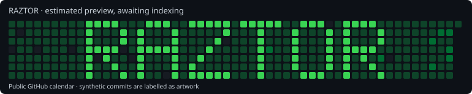

# Contribution Canvas · RAZTOR

Adaptive lettering on the **actual** GitHub contribution calendar. The labelled, empty commits are synthetic artwork and do not represent software development activity.



## Operation

The public calendar is the source of truth: both daily counts and the intensity levels assigned by GitHub. This includes private counts only when the owner has made them publicly visible. An authenticated owner's API view can differ from what profile visitors see, so it is not used for contrast.

`RAZTOR` uses a 5×7 font, one column between letters and a 35-week width. It is centered in the actual visible weeks. Dates follow GitHub's Sunday-to-Saturday cells. Author and committer timestamps use noon UTC on the respective date; no future commits are generated. Each ink pixel receives only enough empty commits to reach its target, considering its real background contributions. Letter holes and background receive no synthetic commits.

The initial target is 2.2× the largest daily baseline count. **This is an estimate, not a claim about GitHub's unpublished color algorithm.** After indexing, the renderer reads actual public levels and measures every horizontal and vertical letter/background boundary. At least 95% must differ by two intensity levels. Actual metrics and whether indexing completed are recorded separately from the preview.

## Two repositories

| Repository | Purpose |
|---|---|
| [`contribution-canvas`](https://github.com/raztor/contribution-canvas) | Permanent source (`engine`), configuration, workflow and receipts (`state`). |
| [`contribution-canvas-pixels`](https://github.com/raztor/contribution-canvas-pixels) | Disposable synthetic history on `main`. **Automatically deleted and recreated. Never store work here.** |

Rewriting a branch does not reliably remove already-indexed contributions. A live three-empty-commit experiment confirmed attribution, persistence after force-push/branch removal, and disappearance after deleting the disposable repository. Weekly replacement therefore uses **repository deletion**, not just a history rewrite.

The deletion code permits exactly `raztor/contribution-canvas-pixels`, never the source repository. It additionally checks the recorded numerical repository ID, owner, public/standalone status, exact nonce-bearing description, ownership marker, single `main` branch and expected head. Tags, releases, issues, pull requests, changed commits or changed identity stop deletion. A repository found without a matching receipt is not adopted or overwritten.

## Weekly replacement and recovery

The workflow runs every six hours at minute 17 (UTC). A change in the public calendar's first Sunday triggers recentering. Intermediate runs check visibility/contrast and resume incomplete operations. Source/configuration changes also request a refresh. Workflow executions are serialized.

Before replacing an indexed drawing, the next budget is preflighted. A persistent deletion receipt is saved **before** the disposable repository is deleted. The renderer then verifies that its old per-day counts actually disappeared, fetches the clean baseline, and builds the new picture. During indexing, it never blindly subtracts a manifest or adds another generation. Creation receipts, a per-generation nonce and deterministic commit IDs permit recovery after interruption. A concurrent modification stops the operation rather than overwriting it.

Each run polls for up to 15 minutes, then defers to the next scheduled run. After a 24-hour indexing timeout it fails visibly without generating another picture. If measured contrast is insufficient, up to two automatic calibration attempts increase the target by 50% each, always verifying complete deletion and respecting the same budgets before rebuilding. Failure after that limit stops for review. The graph may temporarily show no artwork between deletion and indexing. GitHub can delay/drop scheduled runs and disable inactive schedules; this is not a wall-clock guarantee.

## Controls

Open [Actions → Contribution canvas](https://github.com/raztor/contribution-canvas/actions/workflows/canvas.yml), select **Run workflow**, and choose:

| Mode | Result |
|---|---|
| `auto` | Verify and recenter only when the visible week or source/configuration changes. |
| `refresh` | Request a new drawing using the confirmed cleanup sequence. |
| `clear` | Delete the disposable picture, confirm removal and persistently suspend rendering. |
| `resume` | Enable drawing again after `clear`. |

Disabling the workflow stops future runs immediately, but existing artwork remains until `clear` completes. Do not delete the state branch or repeatedly refresh to bypass a pending index. Inspect the receipt and logs if a run fails. If an unexpected modification prevents deletion, preserve that content and resolve it deliberately.

## Configuration and credentials

Edit [`canvas.json`](canvas.json) on `engine`. Default limits are **2,000 synthetic commits per day** and **200,000 per drawing**. Budget violations, incomplete calendars, changed HTML, unsupported characters, oversized text, wrong repository identity and insufficient measured contrast fail closed. A zero-activity background still produces nonzero lettering. The contribution total increases substantially; the exact synthetic amount is recorded per generation.

The source workflow's `GITHUB_TOKEN` needs only `contents: write` to save receipts. `CANVAS_ADMIN_TOKEN` is a separate repository secret with classic `repo` and `delete_repo` permissions, needed to create/push/delete the pixel repository. **GitHub's OAuth deletion permission is account-wide; it cannot be limited to a repository name. The program's checks restrict its use, but do not narrow the credential itself.** Keep source workflow write access limited to trusted maintainers. No token is stored in source, state, artifacts, URLs or logs.

The initial installation used a separately authorized GitHub CLI session. Its extra default scopes are `gist` and `read:org`; existing organization-administration/workflow permissions were not copied. Credentials remain valid until revoked by the owner/provider. Revocation or expiration stops future rendering and is visible in workflow failures.

## Local use

Python 3.11+, Git and authenticated repository access are sufficient; no third-party Python dependencies are required.

```sh
git clone --branch engine https://github.com/raztor/contribution-canvas.git
cd contribution-canvas
python3 -m unittest discover -s tests -v
python3 canvas.py preview
# Read-only outputs: .runtime/plan.json, before.svg, preview.svg
python3 rotate.py --mode auto --wait-seconds 900
# Reads CANVAS_ADMIN_TOKEN; --use-gh-session is available for local use.
```

Only the normal rolling contribution view is targeted. Year/organization filters, owner-only private counts, hidden private activity, mobile cropping, changed themes/palettes and future GitHub behavior can alter the appearance. Real contribution activity cannot be erased; unusually bright backgrounds may require a reviewed target/budget increase. Changes to historical real contributions while cleanup is being verified can make the strict removal check pause for investigation.

## References

- [GitHub contribution eligibility, author email and timestamp rules](https://docs.github.com/en/account-and-profile/reference/profile-contributions-reference).
- [Contribution troubleshooting and indexing latency](https://docs.github.com/en/account-and-profile/how-tos/contribution-settings/troubleshooting-missing-contributions).
- [Scheduled workflow behavior and inactivity](https://docs.github.com/en/actions/reference/workflows-and-actions/events-that-trigger-workflows#schedule).
- [Repository deletion and recovery limitations](https://docs.github.com/en/repositories/creating-and-managing-repositories/deleting-a-repository).
